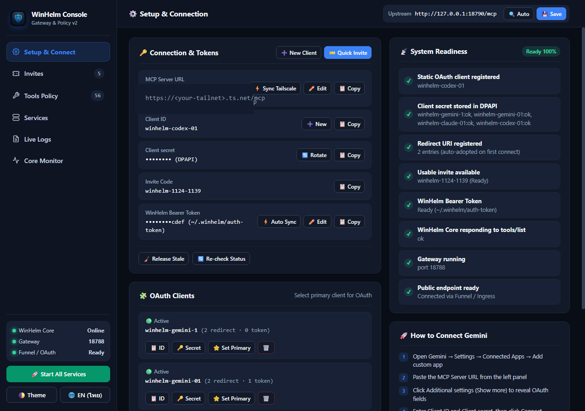
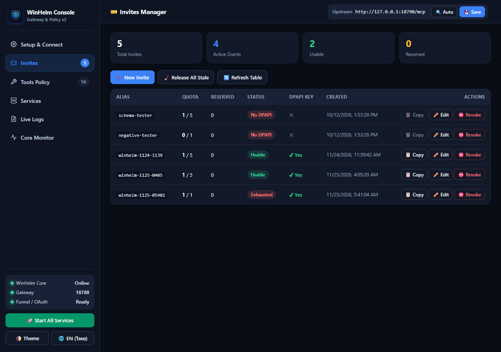
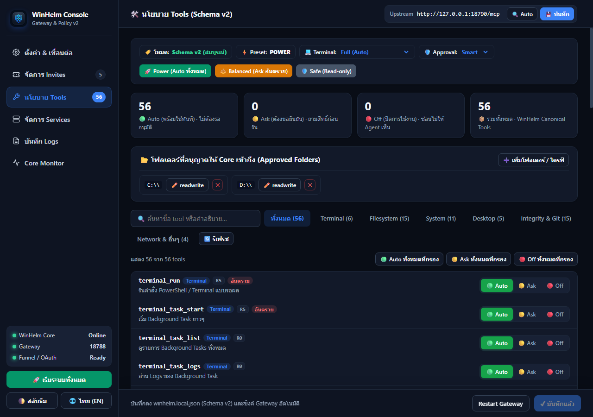
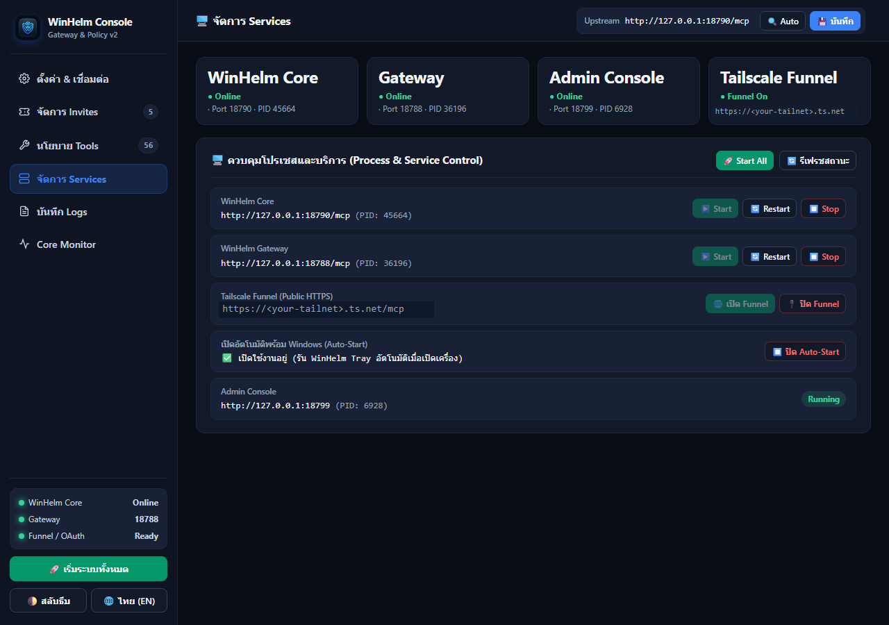

# WinHelm Unified Desktop Console & Multi-Platform Ingress Gateway

> 🌐 **Language:** **English** | [🇹🇭 ภาษาไทย](README.th.md)

A standalone **Desktop Control Console**, **System Tray** app, and **OAuth 2.1 / MCP Ingress Gateway** for **WinHelm MCP Core** — supporting **Google Gemini**, **Anthropic Claude**, and **OpenAI ChatGPT**.

Built with **100% Node.js Standard Library** (zero external npm dependencies), communicating with WinHelm Core over local HTTP + Bearer Token and securing credentials with Windows DPAPI.

---

## 🌟 Key Features

1. **⚙️ Setup & Connection (`#setup`):**
   - One-click **Tailscale Funnel** public domain sync (`⚡ Sync Tailscale`).
   - Create and manage **OAuth Static Clients** (`Client ID` / `Client Secret` encrypted via Windows DPAPI).
   - Manage **WinHelm Core Bearer Token** (auto-reads `~/.winhelm/auth-token`, `⚡ Auto Sync`, or manual entry when running Core with `--auth`).
   - Real-time 8-point **System Readiness** checklist.

2. **🎫 Invites Manager (`#invites`):**
   - Generate Invite Codes with configurable quotas and one-click clipboard copy.
   - Edit quotas, reset usage, release stale reservations (`Release Stale`), revoke, or permanently delete.

3. **🛠️ Tools Policy — Schema v2 (`#tools`):**
   - Per-tool access control across **56 Canonical WinHelm Tools** (`🟢 Auto` / `🟡 Ask` / `🔴 Off`).
   - Quick Presets: `Power (All Auto)`, `Balanced (Ask Risky)`, `Safe (Read-only)`.
   - Configure **Terminal Mode**, **Approval Mode** (`smart` / `manual` / `trusted`), and **Approved Folders** in one place.

4. **🖥️ Services Control & 📜 Live Logs (`#services`, `#logs`):**
   - Start / Stop / Restart **WinHelm Core (`18790`)** and **Gateway (`18788`)** independently, plus toggle Tailscale Funnel and Windows Auto-Start.
   - Full-view **Live Logs** (`stdout` & `stderr`) with ANSI color stripping and auto-refresh.

5. **📊 Core Monitor & Global Approval Popup (`#monitor`):**
   - Live **CPU Load**, **RAM**, **GPU VRAM/Temp**, **Uptime/Sessions**, **Disk Drives**, and Core **Activity Logs**.
   - **Approval Queue + Global Popup:** Whenever an `ask`-policy tool is invoked, a notification popup appears at the top-right across all tabs so you can `✔ Approve` or `✕ Deny` immediately.

6. **⚡ Silent System Tray (`WinHelm Tray.lnk`) & Bilingual UI (`EN / TH`):**
   - Launches cleanly into the Windows System Tray with **no persistent PowerShell window** (via `wscript.exe` + `tray\launch-tray.vbs`).
   - Built-in **English / Thai (`EN / ไทย`)** toggle and **Light / Dark** theme switcher.

---

## 📸 Screenshots

### 1. Setup & OAuth Connection


### 2. Invites Manager


### 3. Tools Policy (Schema v2)


### 4. Services Control & Tailscale Funnel


---

## 🚀 Quick Launch (Already Configured)

- **Recommended (via Tray):** Double-click **`WinHelm Tray.lnk`** (or `start-tray.cmd`), then right-click the WinHelm tray icon → **Open Control Console**.
- **Console Only:** Run `.\start-console.ps1` (opens a 1280×900 Edge App window using a single-use launch ticket).
- **Gateway / Core Only:** Run `.\start-gateway.ps1` / `.\start-core.ps1`, or click **`🚀 Start All Services`** inside the Console.

---

## 📦 Installation on a New Machine

### 1. Prerequisites
- **Windows 10 / 11** with **Microsoft Edge** (built-in)
- **Node.js v20+** — download from [nodejs.org](https://nodejs.org/) or install via `winget install OpenJS.NodeJS.LTS`
- **Tailscale** (signed in with **MagicDNS**, **HTTPS**, and **Funnel** enabled)
- **WinHelm MCP Core** (`winhelm-mcp`)

### 2. Install & Configure Tailscale (Required for Public HTTPS MCP URL)
AI platforms (Gemini, Claude, ChatGPT) require a public `https://` endpoint to reach your local MCP Gateway (`127.0.0.1:18788`).
1. **Install Tailscale on Windows:**
   - Download from [tailscale.com/download/windows](https://tailscale.com/download/windows) or run:
     ```powershell
     winget install Tailscale.Tailscale
     ```
   - Open Tailscale from the System Tray and sign in (or run `tailscale up`).
2. **Enable MagicDNS & HTTPS in Tailscale Admin Console:**
   - Go to [Tailscale Admin Console → DNS](https://login.tailscale.com/admin/dns).
   - Enable **MagicDNS** and **HTTPS Certificates**.
3. **Enable Tailscale Funnel for Port `18788`:**
   - Run once in PowerShell (if Funnel is not enabled on your tailnet yet, Tailscale will print an activation URL — open it to allow Funnel):
     ```powershell
     tailscale funnel --bg 18788
     ```
   - Verify with:
     ```powershell
     tailscale funnel status
     ```
   - *(You can also toggle Funnel ON/OFF later inside WinHelm Console → **Services**.)*

### 3. Install WinHelm MCP Core (`winhelm-mcp`)
`setup.cmd` and `start-core.ps1` automatically detect WinHelm Core in this priority order — choose **one** of the options below:
- **Option A — Clone & build alongside the gateway (Recommended for local dev):**
  ```powershell
  git clone https://github.com/incognitums/winhelm-mcp.git
  cd winhelm-mcp
  npm install
  npm run build
  ```
  Place the `winhelm-mcp` folder next to `winhelm-console-gateway` (so `..\winhelm-mcp\dist\index.js` exists).
- **Option B — Install globally via npm:**
  ```powershell
  npm install -g winhelm-mcp
  ```
- **Option C — Zero-install via `npx`:**
  - If neither Option A nor B is present, the gateway falls back to `npx -y winhelm-mcp` automatically when Node.js is installed.

### 4. First-Run Setup (`setup.cmd`)
1. Clone this repository next to `winhelm-mcp` (or anywhere on your machine):
   ```powershell
   git clone https://github.com/incognitums/winhelm-console-gateway.git
   cd winhelm-console-gateway
   ```
2. Double-click **`setup.cmd`** (verifies Node.js, Edge, Tailscale, and WinHelm Core; initializes `config.json` from `config.example.json` with your Tailscale domain; and creates `WinHelm Tray.lnk`).
3. Double-click **`WinHelm Tray.lnk`** → right-click the tray icon → **Open Control Console** (`http://127.0.0.1:18789`).
4. Click **`🚀 Start All Services`** at the bottom-left (and enable **Tailscale Funnel** in **Services** if not active):
   - On first start, WinHelm Core generates a Bearer Token at `%USERPROFILE%\.winhelm\auth-token`.
   - *Note:* If you run WinHelm Core externally with `--auth <token>`, click **`✏️ Edit`** on **WinHelm Bearer Token** to paste your token.
5. In **Setup & Connection**:
   - Click **`⚡ Sync Tailscale`** (if not synced yet).
   - Click **`➕ New Client`** (e.g., `winhelm-gemini-01`) — the secret is encrypted with DPAPI and copied to your clipboard.
   - Click **`🎫 Quick Invite`** to generate a registration Invite Code.
6. Use the **MCP Server URL**, **Client ID**, **Client Secret**, and **Invite Code** to connect your AI platform below.

---

## 🔌 Connecting AI Platforms (Gemini / Claude / ChatGPT)

> Recommended: Create a dedicated **Client ID per platform** (e.g., `winhelm-gemini-01`, `winhelm-claude-01`, `winhelm-chatgpt-01`) and keep an unused **Invite Code** ready for each connection. Callback URL patterns for all three platforms are supported automatically.

### 1. Google Gemini
1. Go to **Settings → Connected Apps → Add custom app**
2. Paste **MCP Server URL** (`https://<your-tailscale-host>/mcp`)
3. Expand **Additional settings (Show more)** → enter **Client ID** and **Client Secret**
4. Click **Connect** → enter the **Invite Code** on the WinHelm authorization page → click **Continue**

### 2. Anthropic Claude
1. Go to **Settings → Connectors → Add custom connector**
2. Paste **MCP Server URL** (`https://<your-tailscale-host>/mcp`)
3. Expand **Advanced settings** → enter **Client ID** and **Client Secret**
4. Click **Add / Connect** → enter the **Invite Code** → click **Continue**

### 3. OpenAI ChatGPT
1. Go to **Plugins / Apps → Add custom MCP server**
2. Left panel:
   - **Connection:** `Server URL` → `https://<your-tailscale-host>/mcp`
   - **Authentication:** `OAuth`
3. Right panel (**Advanced OAuth settings**):
   - **Registration method:** `User-Defined OAuth Client`
   - **OAuth client ID / OAuth client secret:** from WinHelm Console
   - **Token endpoint auth method:** **`client_secret_post`** (or `client_secret_basic` — *do not select `none`*)
   - **Scopes (if prompted):** leave blank or enter `winhelm:mcp`
   - *(OAuth endpoints are auto-discovered from `/.well-known/*`)*
4. Check **I understand and want to continue** → click **Create as a plugin** → enter the **Invite Code** → click **Continue**

> **Health check:** `/healthz` returns `{"ok":true}` without auth, while `/mcp` always returns `401 Unauthorized` without a valid OAuth Bearer token.

---

## 🔒 Security Model
- **Local Admin Isolation:** Admin Console (`18789`) binds strictly to `127.0.0.1` with `Host` and `Origin` validation and is never exposed via Tailscale Funnel.
- **Single-Use Launch Ticket & Strict Cookie:** Prevents token leakage via browser command-line arguments.
- **Windows DPAPI:** Client Secrets and Invite Codes are encrypted per Windows user via DPAPI.
- **Git Hygiene:** `*.dpapi`, `*.pid`, `*.log`, `*.lnk`, `config-backups/`, and `config.json` are excluded by `.gitignore`.
