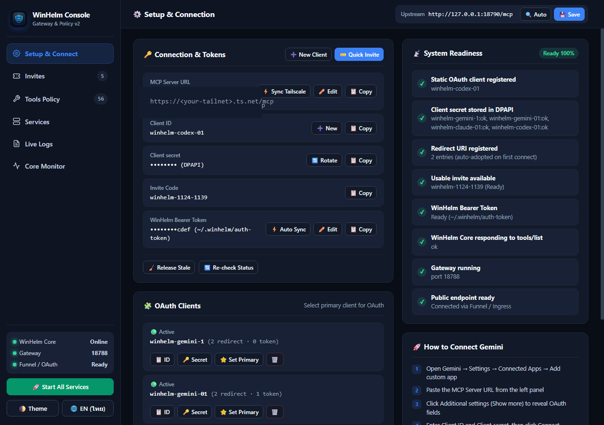
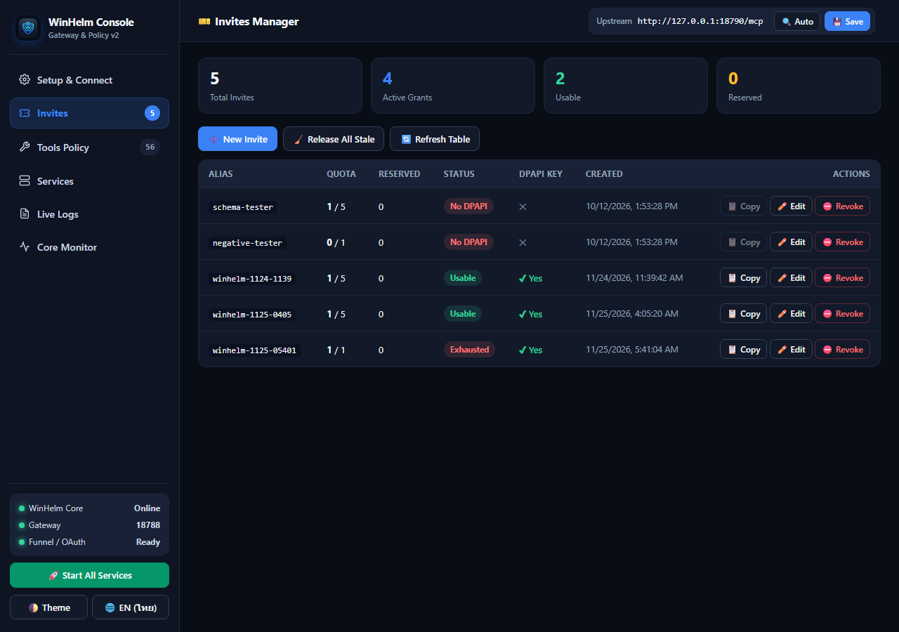
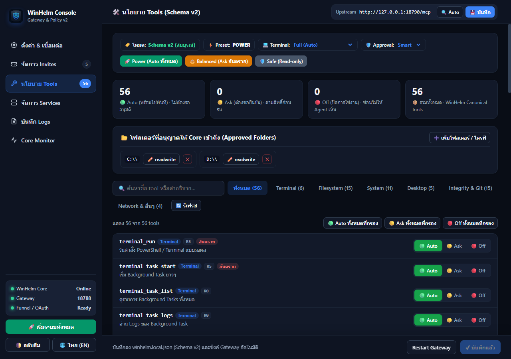
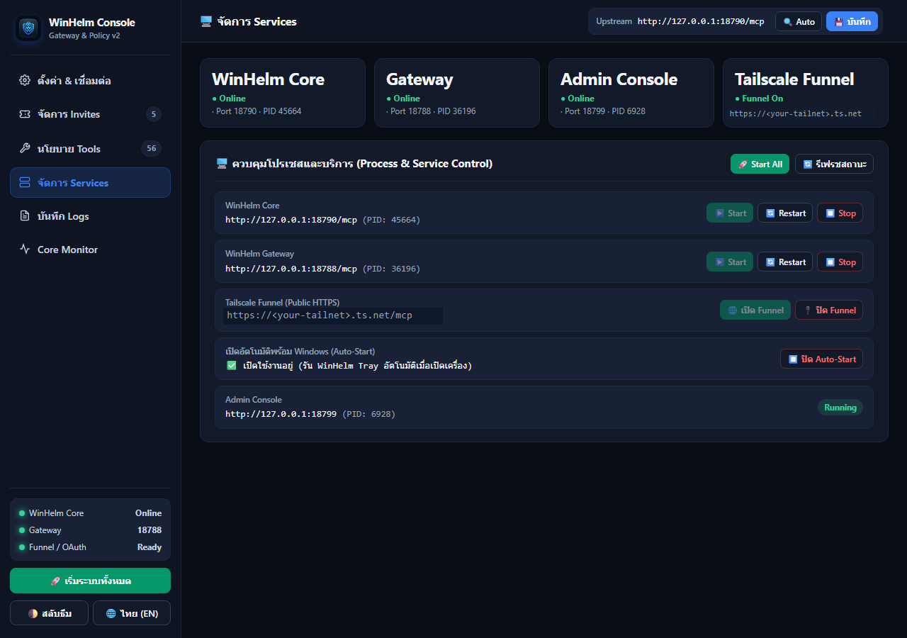

# WinHelm Unified Desktop Console & Multi-Platform Ingress Gateway

> 🌐 **Language:** [🇺🇸 English](README.md) | **🇹🇭 ภาษาไทย**

ศูนย์ควบคุมเดสก์ท็อป (**Control Console**), ระบบ **System Tray**, และ **OAuth 2.1 / MCP Ingress Gateway** สำหรับ **WinHelm MCP Core** (รองรับ **Google Gemini**, **Anthropic Claude**, และ **OpenAI ChatGPT**)

โปรเจกต์นี้ออกแบบให้แยกส่วนจากแกนหลัก (`winhelm-mcp`) อย่างชัดเจน โดยใช้ **Node.js Standard Library 100%** (ไร้ external npm dependencies) ทำงานร่วมกับ WinHelm Core ผ่าน Local HTTP + Bearer Token และเข้ารหัสข้อมูลสำคัญด้วย Windows DPAPI

---

## 🌟 ฟีเจอร์หลัก (Key Features)

1. **⚙️ ตั้งค่า & เชื่อมต่อ (`#setup`):**
   - ซิงค์โดเมนสาธารณะจาก **Tailscale Funnel** อัตโนมัติ (`⚡ ซิงค์ Tailscale`)
   - สร้างและจัดการ **OAuth Static Clients** (`Client ID` / `Client Secret` เข้ารหัสด้วย Windows DPAPI)
   - จัดการ **WinHelm Core Bearer Token** (อ่านอัตโนมัติจาก `~/.winhelm/auth-token`, ปุ่ม `⚡ ซิงค์อัตโนมัติ`, หรือกรอก Token เองเมื่อรัน Core ด้วย `--auth`)
   - **Health Checklist** ตรวจความพร้อมระบบ 8 จุดแบบเรียลไทม์

2. **🎫 จัดการ Invites (`#invites`):**
   - สร้าง Invite Code พร้อมกำหนดโควตา (Quota) และคัดลอกลง Clipboard ในคลิกเดียว
   - แก้ไขโควตา, รีเซ็ตการใช้งาน, ปลดการจองค้าง (`Release Stale`), ยกเลิก (`Revoke`), หรือลบถาวร

3. **🛠️ นโยบาย Tools — Schema v2 (`#tools`):**
   - ควบคุมสิทธิ์ **56 Canonical Tools** ของ WinHelm แบบเจาะจงราย Tool (`🟢 Auto` / `🟡 Ask` / `🔴 Off`)
   - ปุ่ม Quick Presets: `Power (Auto ทั้งหมด)`, `Balanced (Ask คำสั่งอันตราย)`, `Safe (Read-only)`
   - ตั้งค่า **Terminal Mode**, **Approval Mode** (`smart` / `manual` / `trusted`), และจัดการ **Approved Folders** ได้จากหน้าเดียว

4. **🖥️ จัดการ Services & 📜 บันทึก Logs (`#services`, `#logs`):**
   - สั่ง `Start` / `Stop` / `Restart` แยกสำหรับ **WinHelm Core (`18790`)** และ **Gateway (`18788`)** รวมถึงเปิด/ปิด Tailscale Funnel และ Windows Auto-Start
   - หน้า **บันทึก Logs** เต็มจอ (`stdout` & `stderr`) พร้อมล้าง ANSI color codes และ Auto-Refresh

5. **📊 Core Monitor & Global Approval Popup (`#monitor`):**
   - แสดง **CPU Load**, **RAM**, **GPU VRAM/Temp**, **Uptime/Sessions**, **Disk Drives**, และ **Activity Logs** ของ Core
   - **Approval Queue + Global Popup:** เมื่อมีคำสั่งติดสิทธิ์ `ask` ระบบจะเด้ง Popup แจ้งเตือนมุมขวาบนทันทีไม่ว่าอยู่แท็บไหน กด `✔ อนุมัติ` หรือ `✕ ปฏิเสธ` ได้จาก Console โดยตรง

6. **⚡ Silent System Tray (`WinHelm Tray.lnk`) & สองภาษา (`ไทย / EN`):**
   - เปิดแอป System Tray ได้โดย **ไม่มีหน้าต่าง PowerShell ค้าง** (ผ่าน `wscript.exe` + `tray\launch-tray.vbs`)
   - รองรับปุ่มสลับภาษา **ไทย / EN** และธีม **สว่าง / มืด** ในหน้า Console

---

## 📸 ภาพหน้าจอ (Screenshots)

### 1. ตั้งค่า & เชื่อมต่อ (Setup & OAuth Connection)


### 2. จัดการ Invites (Invites Manager)


### 3. นโยบาย Tools — Schema v2 (Tools Policy)


### 4. จัดการ Services & Tailscale Funnel (Services Control)


---

## 🚀 วิธีเปิดใช้งาน (เครื่องที่ติดตั้งแล้ว)

- **วิธีที่แนะนำ (ผ่าน Tray):** ดับเบิลคลิก **`WinHelm Tray.lnk`** (หรือ `start-tray.cmd`) แล้วคลิกขวาที่ไอคอน WinHelm มุมขวาล่าง Taskbar → **Open Control Console**
- **เปิดเฉพาะหน้า Console:** รัน `.\start-console.ps1` (เปิดหน้าต่าง Edge App 1280×900 ไร้แถบ URL พร้อม Single-Use Launch Ticket)
- **เปิดเฉพาะ Gateway / Core:** รัน `.\start-gateway.ps1` / `.\start-core.ps1` หรือกดปุ่ม **`🚀 เริ่มระบบทั้งหมด`** ในหน้า Console

---

## 📦 คู่มือนำไปติดตั้งบนเครื่องใหม่

### 1. ข้อกำหนดเบื้องต้นของเครื่องปลายทาง
- **Windows 10 / Windows 11** พร้อม **Microsoft Edge** (ติดตั้งมากับระบบอยู่แล้ว)
- **Node.js v20+** — ดาวน์โหลดจาก [nodejs.org](https://nodejs.org/) หรือติดตั้งผ่าน `winget install OpenJS.NodeJS.LTS`
- **Tailscale** (ติดตั้ง ล็อกอิน และเปิดใช้งาน **MagicDNS**, **HTTPS**, และ **Funnel**)
- **WinHelm MCP Core** (`winhelm-mcp`)

### 2. ติดตั้งและตั้งค่า Tailscale (จำเป็นสำหรับ Public HTTPS MCP URL)
แพลตฟอร์ม AI (Gemini, Claude, ChatGPT) ต้องเชื่อมต่อผ่าน URL แบบ `https://` สาธารณะเพื่อวิ่งเข้ามายัง MCP Gateway บนเครื่อง (`127.0.0.1:18788`):
1. **ติดตั้ง Tailscale บน Windows:**
   - ดาวน์โหลดจาก [tailscale.com/download/windows](https://tailscale.com/download/windows) หรือรันคำสั่ง:
     ```powershell
     winget install Tailscale.Tailscale
     ```
   - เปิด Tailscale จาก System Tray แล้วล็อกอินเข้าบัญชี (หรือรัน `tailscale up`)
2. **เปิด MagicDNS และ HTTPS ใน Tailscale Admin Console:**
   - เข้าไปที่ [Tailscale Admin Console → DNS](https://login.tailscale.com/admin/dns)
   - เปิดใช้งาน **MagicDNS** และ **HTTPS Certificates**
3. **เปิด Tailscale Funnel ชี้มาที่พอร์ต `18788`:**
   - รันคำสั่งนี้ใน PowerShell (หาก tailnet ยังไม่เคยเปิด Funnel ระบบจะแสดงลิงก์สำหรับกดอนุญาตในหน้าเว็บ Admin Console ให้เปิดลิงก์นั้นแล้วกดยืนยัน):
     ```powershell
     tailscale funnel --bg 18788
     ```
   - ตรวจสอบสถานะด้วย:
     ```powershell
     tailscale funnel status
     ```
   - *(หลังจากนั้นสามารถกดเปิด/ปิด Funnel จากแท็บ **จัดการ Services** ในหน้า WinHelm Console ได้เลย)*

### 3. ติดตั้ง WinHelm MCP Core (`winhelm-mcp`)
สคริปต์ `setup.cmd` และ `start-core.ps1` จะค้นหา WinHelm Core อัตโนมัติตามลำดับด้านล่าง เลือกติดตั้ง **วิธีใดวิธีหนึ่ง**:
- **วิธีที่ A — Clone และ Build ไว้ข้างโฟลเดอร์ Gateway (แนะนำสำหรับใช้งาน/พัฒนาในเครื่อง):**
  ```powershell
  git clone https://github.com/incognitums/winhelm-mcp.git
  cd winhelm-mcp
  npm install
  npm run build
  ```
  วางโฟลเดอร์ `winhelm-mcp` ไว้ข้างๆ `winhelm-console-gateway` (ให้มีไฟล์ `..\winhelm-mcp\dist\index.js`)
- **วิธีที่ B — ติดตั้งแบบ Global ผ่าน npm:**
  ```powershell
  npm install -g winhelm-mcp
  ```
- **วิธีที่ C — ไม่ต้องติดตั้งล่วงหน้า (รันผ่าน `npx`):**
  - หากไม่พบทั้งแบบ A และ B ตัว Gateway จะเรียก `npx -y winhelm-mcp` ให้อัตโนมัติเมื่อมี Node.js ในเครื่อง

### 4. ขั้นตอนตั้งค่าครั้งแรก (`setup.cmd`)
1. Clone โปรเจกต์นี้มาวางบนเครื่อง (ข้างๆ `winhelm-mcp` หรือที่ใดก็ได้):
   ```powershell
   git clone https://github.com/incognitums/winhelm-console-gateway.git
   cd winhelm-console-gateway
   ```
2. ดับเบิลคลิก **`setup.cmd`** (สคริปต์จะตรวจ Node.js, Edge, Tailscale, WinHelm Core, สร้าง `config.json` จาก `config.example.json` พร้อมดึงโดเมน Tailscale และสร้าง Shortcut `WinHelm Tray.lnk` ให้ตรงกับโฟลเดอร์ปัจจุบันอัตโนมัติ)
3. ดับเบิลคลิก **`WinHelm Tray.lnk`** แล้วคลิกขวาที่ไอคอน WinHelm มุมขวาล่าง → **Open Control Console** (`http://127.0.0.1:18789`)
4. กดปุ่ม **`🚀 เริ่มระบบทั้งหมด`** ที่มุมล่างซ้าย (และเปิด **Tailscale Funnel** ในแท็บ **จัดการ Services** หากยังไม่เปิด):
   - การรันครั้งแรก WinHelm Core จะสุ่มสร้าง Bearer Token ไว้ที่ `%USERPROFILE%\.winhelm\auth-token` ให้อัตโนมัติ
   - *หมายเหตุ:* หากคุณรัน WinHelm Core เองจากภายนอกด้วย `--auth <token>` ให้กด **`✏️ แก้ไข`** ตรงแถว **WinHelm Bearer Token** เพื่อวาง Token ของคุณ
5. ในแท็บ **ตั้งค่า & เชื่อมต่อ**:
   - กด **`⚡ ซิงค์ Tailscale`** (หากยังไม่ได้ซิงค์)
   - กด **`➕ สร้าง Client`** (เช่น `winhelm-gemini-01`) ระบบจะสร้าง Secret (เข้ารหัส DPAPI) และคัดลอกลง Clipboard ให้
   - กด **`🎫 สร้าง Invite ด่วน`** เพื่อสร้าง Invite Code สำหรับยืนยันตัวตนครั้งแรก
6. นำ **MCP Server URL**, **Client ID**, **Client Secret**, และ **Invite Code** ไปเชื่อมต่อกับ AI Platform ด้านล่าง

---

## 🔌 วิธีเชื่อมต่อ AI Platforms (Gemini / Claude / ChatGPT)

> แนะนำให้สร้าง **Client ID แยกตามแพลตฟอร์ม** (เช่น `winhelm-gemini-01`, `winhelm-claude-01`, `winhelm-chatgpt-01`) และเตรียม **Invite Code** ที่ยังไม่ถูกใช้งานไว้ 1 รหัสต่อการเชื่อมต่อ (ระบบรองรับการตรวจจับ callback URL ของทั้ง 3 เจ้าอัตโนมัติ)

### 1. Google Gemini
1. ไปที่ **Settings → Connected Apps → Add custom app**
2. วาง **MCP Server URL** (`https://<your-tailscale-host>/mcp`)
3. เปิด **Additional settings (Show more)** → กรอก **Client ID** และ **Client Secret**
4. กด **Connect** → กรอก **Invite Code** ในหน้าล็อกอิน WinHelm → กด **Continue**

### 2. Anthropic Claude
1. ไปที่ **Settings → Connectors → Add custom connector**
2. วาง **MCP Server URL** (`https://<your-tailscale-host>/mcp`)
3. เปิด **Advanced settings** → กรอก **Client ID** และ **Client Secret**
4. กด **Add / Connect** → กรอก **Invite Code** → กด **Continue**

### 3. OpenAI ChatGPT
1. ไปที่ **Plugins / Apps → Add custom MCP server**
2. ตั้งค่าฝั่งซ้าย:
   - **Connection:** `Server URL` → `https://<your-tailscale-host>/mcp`
   - **Authentication:** `OAuth`
3. เปิด **Advanced OAuth settings** ด้านขวา:
   - **Registration method:** `User-Defined OAuth Client`
   - **OAuth client ID / OAuth client secret:** กรอกค่าของ Client ที่สร้างใน WinHelm Console
   - **Token endpoint auth method:** เลือก **`client_secret_post`** (หรือ `client_secret_basic` — *ห้ามเลือก `none`*)
   - **Scopes (หากต้องระบุ):** ปล่อยว่างไว้ หรือใส่ `winhelm:mcp`
   - *(ช่อง OAuth endpoints ระบบค้นหาอัตโนมัติจาก `/.well-known/*` ให้เอง)*
4. ติ๊ก **I understand and want to continue** → กด **Create as a plugin** → กรอก **Invite Code** → กด **Continue**

> **หมายเหตุการตรวจสอบ:** `/healthz` จะตอบ `{"ok":true}` โดยไม่ต้องใช้ Token ส่วน endpoint `/mcp` จะตอบ `401 Unauthorized` เสมอเมื่อไม่มี OAuth Bearer Token

---

## 🔒 โครงสร้างความปลอดภัย (Security Model)
- **Local Admin Isolation:** Admin Console (`18789`) รับการเชื่อมต่อเฉพาะ `127.0.0.1` เท่านั้น พร้อมตรวจ `Host` และ `Origin` และไม่ถูกเผยแพร่ออก Tailscale Funnel
- **Single-Use Launch Ticket & Strict Cookie:** ป้องกัน Token รั่วไหลผ่าน Command Line ของเบราว์เซอร์
- **Windows DPAPI:** Client Secret และ Invite Code เข้ารหัสด้วย DPAPI ระดับผู้ใช้
- **Git Hygiene:** `*.dpapi`, `*.pid`, `*.log`, `*.lnk`, `config-backups/`, และ `config.json` ถูกกันไม่ให้ commit ด้วย `.gitignore`
